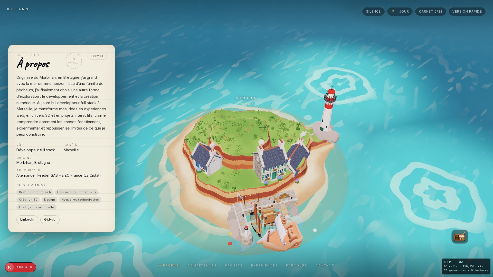

# Revue visuelle de l’archipel

> Note : cette revue date du 14 novembre 2026. Depuis, la direction artistique proposée ici
> a été fusionnée dans la branche unique `Portfolio` et le site est publié.

Branche de travail d'origine : `codex/archipel-art-direction` (supprimée après fusion). Base Claude : `b8626346fbd35eacaf7d677e966587aafc9f3fdc`.

## Capture réellement observée

Capture Chromium 1920×1080, rendu logiciel SwiftShader, issue du run 43640234940 (commit c75f550, scènes de b862634 inchangées). Ce moteur ne permet pas de conclure aux performances sur GPU ou téléphone réel.

## Direction proposée

- Cel-shading à deux paliers plus contrastés, liseré atténué pour conserver les aplats.
- Océan bleu plus profond, reflets graphiques discrets et écume espacée.
- UI d’atlas, carte accessible en un clic, lecture et contemplation séparées.
- Son volontaire, accès recruteur dès le chargement, introduction passable.

## Validation

Le build et le lint de la première passe UI sont passés localement. Les nouveaux shaders doivent encore être validés dans un vrai contexte WebGL.
Le premier run a capturé À propos puis dépassé le délai sur Compétences. Le second a échoué sur une connexion refusée au démarrage. Le runner attend maintenant une réponse HTTP valide et répartit les scènes en jobs indépendants.

Les artefacts `portfolio-review-<île>-<commit>` contiennent les vues desktop/mobile et le rapport JSON du commit testé. Une capture isolée utilise `?solo=...`, `?section=...`, `?time=...` et la qualité basse pour le rendu logiciel. Elle ne valide pas la scène complète ni la haute qualité.

## Reste à vérifier

Les sept décors, l’introduction, la carte, la navigation complète, la version rapide, le clavier et reduced-motion, le jour/nuit, la perte WebGL et un téléphone réel. Aucune prévisualisation publique n’a été déployée. Ne pas présenter cette passe comme une finition Awwwards validée.
